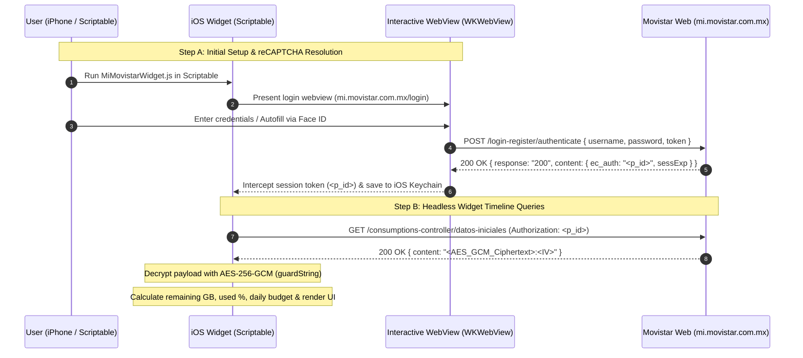

# Movistar México Widget API & Architecture Specification

This document provides a technical specification of the reverse-engineered web architecture, cryptographic layers, authentication mechanics, REST endpoints, and decrypted JSON schemas required to build an iOS home screen data widget for **Movistar México** (`mi.movistar.com.mx`).

---

## 1. Executive Architecture Overview



### Key Technical Parameters

| Attribute | Specification |
| :--- | :--- |
| **Portal Host** | `https://mi.movistar.com.mx` |
| **Auth Flow** | WebLogin with **Google reCAPTCHA v3** (`sitekey: 6LcvRzseAAAAAAv639uV9uh6vRHRBSi0Jk_fsaRf`) |
| **Session Identifier** | `p_id` (also returned as `content.ec_auth` in authenticate response) |
| **Payload Encryption** | **AES-256-GCM** (128-bit authentication tag, 12-byte random IV) |
| **Cryptographic Key** | Static `guardString` Base64 key embedded in `compile/guard_util.js` |
| **WAF / Bot Defense** | Cloudflare (`__cf_bm`, `cf_clearance`) + reCAPTCHA v3 |
| **Session Lifetime** | Governed by `sessExp` (typically valid for multiple days) |

---

## 2. Cryptographic Layer (`AES-256-GCM`)

Movistar secures payload data in transit using client-side WebCrypto `AES-GCM`.

### 2.1 Static Key (`guardString`)

The production key is stored in `https://mi.movistar.com.mx/compile/guard_util.js` and inlined into `login`:

```javascript
const guardString = "MDM4MTg5NTQwNzIyNjEyNjc5MzM5MjE0NTMwMjgwNjg=";
```

When decoded from Base64, this yields the 32-byte raw ASCII key:
```text
03818954072261267933921453028068
```

### 2.2 Wire Format

Ciphertexts are serialized as a colon-separated string of two URL-safe Base64 strings:
```text
<base64url(ciphertext_with_16_byte_auth_tag)>:<base64url(12_byte_iv)>
```
*Note: Characters `-` and `_` replace standard Base64 `+` and `/`, and padding `=` is stripped.*

### 2.3 Decryption Algorithm (`dxyz`)

1. Split input by `:` into `[encryptedBase64, ivBase64]`.
2. Restore standard Base64 padding (`=` modulo 4) and replace URL characters.
3. Import the 32-byte `guardString` key using `crypto.subtle.importKey("raw", keyBytes, { name: "AES-GCM" }, false, ["decrypt"])`.
4. Decrypt via `crypto.subtle.decrypt({ name: "AES-GCM", iv, tagLength: 128 }, key, encryptedBytes)`.
5. Decode UTF-8 plaintext bytes into the JSON response string.

---

## 3. Endpoints Specification

### 3.1 Authenticate (`POST /login-register/authenticate`)

Used during initial in-app interactive setup or re-authentication.

- **URL:** `https://mi.movistar.com.mx/login-register/authenticate`
- **Method:** `POST`
- **Headers:**
  ```http
  Content-Type: application/json
  User-Agent: Mozilla/5.0 (iPhone; CPU iPhone OS 17_5 like Mac OS X) AppleWebKit/605.1.15
  ```
- **Request Body:**
  ```json
  {
    "username": "<cxyz(10_digit_phone)>",
    "password": "<cxyz(password)>",
    "token": "<google_recaptcha_v3_token>"
  }
  ```
- **Response (`200 OK`):**
  ```json
  {
    "response": "200",
    "content": {
      "ec_auth": "P_ID_SESSION_TOKEN_STRING",
      "sessExp": "2026-10-30T04:36:22.000Z",
      "redirect": "/consumptions",
      "userImage": "..."
    }
  }
  ```

---

### 3.2 Query Consumption Data (`GET /consumptions-controller/datos-iniciales`)

The primary polling endpoint used by the iOS widget timeline.

- **URL:** `https://mi.movistar.com.mx/consumptions-controller/datos-iniciales`
- **Method:** `GET`
- **Headers:**
  ```http
  Authorization: <p_id_session_token>
  Content-Type: application/json
  User-Agent: Mozilla/5.0 (iPhone; CPU iPhone OS 17_5 like Mac OS X) AppleWebKit/605.1.15
  ```
  *(Important: `Authorization` takes the raw session token directly, without a `Bearer` prefix).*
- **Encrypted Response (`200 OK`):**
  ```json
  {
    "content": "A5F9kL...ciphertext...==:X8d1...iv...=="
  }
  ```

#### Decrypted JSON Schema

```json
{
  "offering": "Movistar Libre 10GB",
  "userType": 1,
  "bolton": [
    {
      "name": "Navegación",
      "vigencia": "28/10/2026",
      "consumption": 65,
      "consumptionLabel": "Llevas 6.50 GB de 10.00 GB",
      "totalBenefit": "10.00 GB"
    },
    {
      "name": "Redes Sociales",
      "vigencia": "28/10/2026",
      "consumption": 0,
      "consumptionLabel": "Ilimitado",
      "totalBenefit": "Ilimitado"
    },
    {
      "name": "Minutos y SMS",
      "totalBenefit": "Ilimitado"
    }
  ],
  "saldos": {
    "totalBalance": "150.00",
    "giftBalance": "0.00",
    "topupsBalanceExpiration": "28/10/2026",
    "topupsBalanceExpirationDate": 1793145600000,
    "topupsBalanceCurrentDate": 1792469182000
  }
}
```

---

### 3.3 Parsing & Metric Computations

1. **Remaining Data:**
   - From `bolton[0].consumptionLabel`: `"Llevas 6.50 GB de 10.00 GB"`.
   - Used: `6.50 GB` (6,656 MB).
   - Total: `10.00 GB` (10,240 MB).
   - Remaining: `10.00 - 6.50 = 3.50 GB` (3,584 MB).
2. **Usage Percentage:**
   - `bolton[0].consumption` contains the integer percentage (e.g. `65%`).
3. **Countdown to Cutoff:**
   - Parse `bolton[0].vigencia` (`DD/MM/YYYY`).
   - `daysLeft = Math.ceil((targetDate - now) / 86,400,000)`.
4. **Daily Budget Allowance:**
   - `dailyMB = remainingMB / daysLeft`.
   - If $\ge 1024 \text{ MB}$, format as `X.XX GB/d`; otherwise `XXX MB/d`.
5. **Recharge Balance:**
   - `saldos.totalBalance` contains available prepaid balance (`$150.00`).
